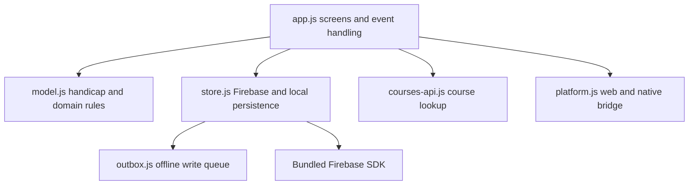

# JavaScript Function Reference — The Scorecard

**Source reviewed:** `willyros01/scorecard`, `main` (web source), with the shared application files also compared against `v2` (iOS source) and `android`.  
**Purpose:** a code-level companion to `APP-CODE-GUIDE.md`. This is documentation only; it does not change application behavior.

> **Branch note.** The web, iOS and Android branches share the domain and data architecture, but `app.js` and `platform.js` contain branch/platform-specific integration details. Read the matching branch before changing code. The descriptions below use the current `main` source as the reference snapshot. They describe the purpose and contracts of the important functions, not a guarantee that every internal helper is a public API.

## 1. Application layers

The intended dependency direction is important:

- `app.js` owns presentation and user interaction.
- `model.js` owns golf and group-domain calculations. It must not import Firebase, access the DOM, or write storage.
- `store.js` owns Firestore, authentication, listeners, and persistence.
- `outbox.js` records writes that cannot yet reach Firestore.
- `platform.js` is the single boundary for browser versus Capacitor behavior.
- `courses-api.js` isolates the optional third-party course-search provider.

A change to a handicap rule belongs in `model.js`, not in a screen or Firebase callback. A change to Firestore paths belongs in `store.js`, not in the screen renderer.

## 2. `model.js` — pure domain logic

This module deliberately has no Firebase or browser dependency. Its functions are deterministic domain transformations and are suitable for unit tests.

### IDs and join codes

| Function | Purpose and technical behavior |
|---|---|
| `newId()` | Makes a compact client-side identifier from the current time in base 36 plus a random suffix. It is an application ID, not an authentication credential. |
| `newJoinCode(length = 6)` | Generates a human-readable group code. The alphabet excludes easily confused characters such as I/O/0/1/S/5. |
| `normalizeJoinCode(code)` | Uppercases a supplied code and removes punctuation/spacing before lookup. |

### Handicap calculations

| Function | Purpose and technical behavior |
|---|---|
| `differential(adjustedGross, courseRating, slopeRating)` | Computes `(113 / slope) × (adjusted gross − course rating)`, rounded to one decimal. Inputs are converted to numbers. |
| `handicapIndex(differentialsChronological)` | Uses at most the latest 20 differentials. Fewer than 3 returns `null`. The `SCALE` table chooses the number of lowest differentials and any early-round adjustment; the result is capped at 54 and rounded to one decimal. |
| `countingRounds(howManyRounds)` | Returns how many lowest differentials count for the current number of rounds. Used to explain counting versus non-counting rounds in the trend/history UI. |
| `courseHandicap(index, slopeRating, courseRating, par)` | Converts a Handicap Index into a course handicap using the course slope, rating and par. |
| `clampIndex(value)` | Validates a manually entered index; rejects empty, null and non-numeric values, rounds to one decimal and bounds it from 0 to 54. |
| `effectiveIndex(golfer)` | Chooses the index source. A directory-sourced golfer uses the published directory index; otherwise three or more real rounds take precedence; a manual starting index is used only before enough rounds exist. Returns both `index` and a source label. |
| `displayIndex(window)` | Converts a stored recent window to a displayable index; returns `null` until three valid rounds are present and prevents a negative display index. |

### Recent-round window

The golfer record carries a bounded, newest-first `recentWindow` of entries shaped around `roundId`, `date`, `differential` and group identity. This avoids repeatedly querying the complete round history just to calculate an index.

| Function | Purpose and technical behavior |
|---|---|
| `insertIntoWindow(window, entry, limit = 20)` | Removes any previous entry for the same round, inserts the new entry, sorts newest-first and truncates to the limit. |
| `removeFromWindow(window, roundId)` | Removes a deleted/edited round from the cached window. |
| `windowFromOtherGroups(window, assocId)` | Selects entries belonging to groups other than the group currently being rebuilt. This preserves a golfer's cross-group handicap history. |
| `mergeWindow(kept, fresh, limit = 20)` | Combines preserved and rebuilt entries, sorts newest-first and keeps the newest bounded set. |
| `windowToChronological(window)` | Converts newest-first entries into oldest-first differential values, the order expected by the handicap calculation. |
| `indexFromWindow(window)` | Convenience composition of chronological conversion and `handicapIndex`. |
| `sanitizeWindow(window, knownRoundIds)` | Removes stale entries whose round IDs no longer exist, missing IDs/dates, and null or invalid differentials. A `Set` is accepted for efficient membership checks. |
| `affectsWindow(window, date, limit = 20)` | Determines whether a new/backdated round can change a full window. A round older than the oldest entry in a full window cannot change the current index. |

### Round, golfer, game and ranking objects

| Function | Purpose and technical behavior |
|---|---|
| `buildRound({...})` | Creates the canonical round document. Copies course/tee name, rating, slope and par into the round so later course edits do not rewrite history. Computes the differential and freezes the course handicap/index at entry. The server supplies `enteredAt`. |
| `buildGolfer({...})` | Creates a golfer identity with normalized `nameKey`, optional linked account and validated manual starting index; initializes round count and recent window. |
| `nameKey(name)` | Normalizes a person's name for duplicate detection and stable matching. |
| `gameCovers(game, date)` | Checks whether a round date falls inside a game's date span. |
| `gameDays(game)` | Expands a game date range into its individual dates. |
| `gameStandings(rounds, golfers, game)` | Builds the game's standings from eligible rounds and golfer records. |
| `gameSpanLabel(game)` | Produces a readable label for the game's date range. |
| `buildMember({...})` | Creates the group membership record, keeping account UID, display name, role and join-code relationship separate from the golfer identity. |
| `migrateFromV1(v1, options)` | Converts the older single-group data shape into the newer group/member/golfer/round structure. Uses stable IDs/name matching to avoid creating duplicates during migration. |
| `netScore(round)` | Derives a net score from the stored gross and frozen course-handicap data. |
| `gameLeaderboard(rounds, golfers)` | Aggregates eligible rounds into a game leaderboard. |
| `periodRanking(rounds, golfers, {minRounds})` | Builds a ranking for a time period, enforcing the configured minimum number of rounds. |
| `inPeriod(round, {year, month})` | Tests whether a round belongs to the selected calendar period. |

**Important data rule:** a golfer is a person, not a group membership. Their handicap window spans all groups. The same golfer should not acquire separate indexes merely because they play in different groups.

## 3. `outbox.js` — offline write queue

This module has no Firebase import. It stores pending operations in localStorage under `golf:v2:outbox` and receives a writer callback from the data layer.

| Function | Purpose and technical behavior |
|---|---|
| `pending()`, `count()`, `isEmpty()` | Read the queued operations or report queue size/state. |
| `enqueue({type, path, data, writes, opId})` | Adds a durable operation with a unique operation ID, timestamp and attempt counter. Supports set/update/delete and atomic batch entries. |
| `enqueueOrMerge(operation)` | Coalesces repeated offline updates to the same document. It never merges batches. A create followed by a delete can be cancelled locally; a later update can merge into an earlier set/update. |
| `remove(opId)` | Removes an operation only by its stable operation ID. |
| `clear()` | Clears the queue; should be used only by an intentional reset path. |
| `flush(writer)` | Replays oldest-first. It awaits each write and removes it only after success. Transient failure stops the run to preserve ordering. Permanent failures or operations exceeding 50 attempts are moved to the abandoned list so one impossible write cannot block every later write. Returns sent/failed/remaining/stoppedOn information. |
| `abandoned()` | Reads the retained failed-operation record so it can be surfaced rather than silently lost. |

**Idempotency and ordering:** `opId` identifies one logical operation; replay must be safe. Batches remain a single queue entry because splitting an atomic group of writes could leave partially applied data. Permanent errors include permission, missing-document, invalid-argument, failed-precondition and unauthenticated failures.

## 4. `store.js` — application data and Firebase boundary

This is the main persistence module imported by `app.js`. It imports `model.js`, `outbox.js` and `platform.js`. It owns Firestore references, listeners, authentication, local cache, pending writes and the data contracts exposed to the UI.

### Startup, status and persistence

| Function | Purpose and technical behavior |
|---|---|
| `init()` | Initializes the bundled Firebase modules, authentication, Firestore, offline cache and initial listeners. Emulator selection is controlled by the explicit emulator query flag. |
| `onChange(fn)` | Registers a callback for data/status changes. The returned unsubscribe function should be retained by callers that no longer need updates. |
| `status()` | Returns the current connection/status text, alert state, UID/configuration and last error for the UI. |
| `readsOffline()`, `offlineCopyUnavailable()` | Report whether the current read is from an offline path or persistent cache is unavailable. |
| `flush()` | Sends queued outbox operations through the Firestore writer and reports queue state. |
| `abandonedWrites()` | Exposes operations the queue deliberately moved aside after permanent/too-many failures. |
| `shutDown()`, `stopWatching()` | Tear down active subscriptions and listeners during app lifecycle changes. |

### Groups, memberships and invitations

| Function | Purpose and technical behavior |
|---|---|
| `createAssociation({...})` | Creates a group/association and its initial owner membership using the current signed-in account. |
| `findAssociationByCode(code)`, `roleForCode(associationId, code)` | Resolves a join code and its role without making the UI construct Firestore paths. |
| `joinAssociation({...})` | Joins a group through the validated code/member flow. |
| `loadMembership(id)`, `loadAssociation(id)`, `watchMembers(callback)`, `watchAssociation(callback)` | Read or subscribe to the active group and its members. |
| `myRole()`, `canManage()`, `isOwner()` | Central role checks. Screens should use these rather than duplicating role logic. |
| `inviteLink(role, golferId)`, `loadInvitation(link)`, `acceptTokenInvite(...)`, `acceptNamedInvite(...)` | Create, resolve and accept invitation flows. Link/token validation and Firestore writes remain in this module. |
| `submitApplication(...)`, `watchApplications(...)`, `approveApplication(...)`, `rejectApplication(...)`, `sendApprovalLink(...)` | Public-group/application and approval workflow. |
| `submitGroupRequest(...)`, `watchGroupRequests(...)`, `claimGroupRequest(...)`, `finishGroupRequest(...)`, `releaseGroupRequest(...)`, `declineGroupRequest(...)` | Group-request lifecycle, including claim/release to avoid two administrators processing the same request concurrently. |
| `createAnotherGroup(...)`, `groupsFromMemberships()`, `loadMyGroups()`, `knownGroups()`, `forgetGroup(...)` | Multi-group creation, discovery and local remembered-group state. |

### Golfers, rounds, courses and games

| Function | Purpose and technical behavior |
|---|---|
| `watchGolfers(callback)`, `watchRoster(callback)`, `watchRounds(callback)`, `watchCourses(callback)`, `watchGames(callback)` | Subscribe to the active group's data. Each watcher returns/uses a stop mechanism so old subscriptions do not leak across group changes. |
| `findMyGolfer()`, `myGolferId()`, `myGolferIdNow()`, `linkGolferForMember(...)` | Resolve the signed-in account to the golfer identity. |
| `addGolfer(...)`, `renameGolfer(...)`, `removeFromRoster(...)`, `claimGolfer(...)`, `addExistingToRoster(...)`, `removeMemberships(...)` | Maintain golfer identities, roster membership and account linkage. |
| `postRound({...})` | Creates a round and updates the golfer's recent-differential window through the write path. |
| `rebuildGolferIndex(golferId)`, `deleteRoundAndRebuild(round)` | Reconstruct the index/window after a deletion or correction, rather than merely changing the displayed index. |
| `updateRound(...)`, `updateRoundAndRebuild(...)`, `deleteRound(...)`, `canEditRound(round)` | Edit/delete rounds while maintaining the index and edit-permission rules. |
| `addCourse(...)`, `updateCourse(...)`, `canEditCourse(course)`, `setCourseHidden(...)`, `hiddenCourses()` | Maintain course and tee records, with ownership checks and per-user hiding. |
| `addGame(...)`, `updateGame(...)`, `deleteGame(...)`, `publishGameResults(...)`, `updateGameDetails(...)`, `recalculateGameHandicaps(...)`, `setGameRounds(...)` | Create and maintain games, their round membership and derived results/handicaps. |
| `restoreBackup(...)` | Restores golfer/course/round data through the data layer; it is not a blind localStorage replacement. |

### Authentication, account and administration

| Function | Purpose and technical behavior |
|---|---|
| `signInWithEmail(...)`, `sendPasswordReset(email)`, `setMyPassword(...)`, `createMyPassword(password)`, `loadPasswordState()`, `markPasswordCreated()` | Email/password authentication and first-password state. |
| `isSignedIn()`, `hasUser()`, `isAnonymousSession()`, `currentEmail()`, `accountLabel()`, `hasPassword()`, `needsPassword()` | Read-only account state for screens and access decisions. |
| `sendEmailConfirmation()`, `refreshEmailState()`, `emailConfirmed()`, `emailHasAccount(email)`, `ensureAccountEmail()`, `removeAccountEmail()` | Manage/verify account email state. |
| `signOutHere()`, `signOutEverywhere()` | Sign-out operations and related local state cleanup. |
| `deleteMyAccount(...)`, `checkPendingDeletion()`, `deletionBlockers()`, `dismissAbandoned()` | Multi-step account deletion and recovery state. The flow records progress so an interrupted deletion can be resumed or diagnosed. |
| `loadOwnerCockpit()`, `readApplicationSettings()`, `saveApplicationSettings(...)`, `watchBlockList(...)`, `addBlock(...)`, `removeBlock(...)`, `watchReports(...)`, `reportGolfer(...)`, `dismissReport(...)` | Owner/admin tools, configuration, reports and block-list management. |

**Concurrency detail:** many Firestore writes use update-time preconditions. If the document changes after it was read, the write conflicts and the code can re-read/recalculate rather than overwrite newer data.

## 5. `app.js` — screens, user journeys and event handling

`app.js` is the presentation/controller layer. It imports the data module as `db`, the pure domain module as `model`, the course lookup adapter as `lookup` and the platform adapter as `platform`. It contains screen renderers and user-action handlers; it should not become a second source of handicap math or Firestore rules.

### Screen/render functions

| Function family | Main functions and responsibility |
|---|---|
| Entry and account | `entryScreen`, `screenSignedOut`, `signInCard`, `createAccountHere`, `finishSignIn`, `acceptInvite`, `joinByCode`, `createAccountHere`, `screenTerms`, `recordTermsOnAccount` — show sign-in, account creation, terms, invite and group-joining states. |
| Applications and group requests | `screenApply`, `screenFinishApply`, `screenGroupRequest`, `applicationsSection`, `groupRequestsSection`, `approveRequestHere`, `finishApplyHere`, `submitApplicationHere`, `checkPublicApproval` — application intake, approval and group-request workflow. |
| Round entry and history | `screenEnter`, `enterInSteps`, `screenHistory`, `screenSummary`, `trendChart`, `buildTrendChart` — round-entry UI, score history, summary statistics and trend visualization. |
| Games and rankings | `screenGames`, `gameEditor`, `fastEntryPanel`, `gameDetail`, `rankingSection`, `groupRankingSection`, `gameShareText`, `rankingShareText` — game setup, standings, rankings and share text. |
| Group and administration | `screenManage`, `groupSwitcher`, `screenAdmin`, `peopleSection`, `groupSection`, `applicationsTab`, `settingsTab`, `ownerCockpitSection`, `loadOwnerCockpitHere` — group management, membership and owner/admin screens. |
| Backup and maintenance | `backupSection`, `backupData`, `openBackupSheet`, `saveBackup`, `downloadBackup`, `openPasteRestore`, `askForBackupFile`, `restoreBackup` (data operation in store) — create/download a backup and start restore. |
| Shared UI helpers | `render`, `renderNow`, `renderTabs`, `visibleTabs`, `paintBusy`, `busy`, `idle`, `openNotice`, `openProblem`, `flashMsg` — render current state, busy indicators and accessible notices/errors. |

### Important action handlers

- `begin()` starts app initialization and coordinates data/auth state before selecting the first screen.
- `signIn()` and `finishSignIn(...)` complete sign-in and establish the current account/group context.
- `createGroup(...)`, `addGolfer(...)`, `saveRename(...)`, `saveCourse(...)`, `saveGame(...)` validate screen input and delegate persistent changes to `store.js`.
- `runFinder()` delegates course search to `courses-api.js`.
- `postRound()` delegates round persistence to the store; the model remains the source of round/handicap rules.
- `start(assocId)`, `settleGroup(...)`, `settleGroupInner(...)`, `loadInvitedDetails()` coordinate active-group switching and its data subscriptions.
- `scheduleDirectoryRefresh()` schedules directory synchronization after relevant roster/index changes.
- `applyBlocks()` applies administrative block state to the current UI.
- `refreshScope()` and hint-update helpers recalculate the visible golfer/course/game scope after state changes.

The screen functions return HTML strings and the app uses a centralized delegated action system rather than attaching a separate listener to every generated control. Keep user-provided text HTML-escaped (the local `esc` helper) before inserting it into generated markup.

## 6. `platform.js` — browser/Capacitor adapter

This is the only intended place where platform-specific behavior is selected.

| Function | Purpose and technical behavior |
|---|---|
| `isApp()` | Checks whether Capacitor reports a native platform. |
| `plugin(name)` | Resolves a native plugin only when running in the native app. |
| `webBase()`, `guideUrl()`, `privacyUrl()`, `conductUrl()`, `supportUrl()`, `joinBase()` | Centralize external addresses so screens do not hard-code platform destinations. |
| `takeLink(url)` | Accepts an incoming invitation URL, normalizes its join key and suppresses duplicate deliveries (cold start plus app-open event). |
| `linkQuery()`, `signInLinkUrl()`, `clearLinkQuery()`, `initLinks()`, `onLink(handler)` | Normalize web query-string links and native Capacitor deep-link events into one app-facing invitation flow. |
| `canShare()`, `share({...})`, `copy(text)` | Use native share/copy plugins when available; otherwise use browser APIs/fallbacks. |
| `saveFile(name, text, title)` | Saves text through native file/share behavior or browser download behavior. |
| `openExternal(url, how)` | Opens an external destination using the correct browser/native mechanism. |

**Adapter contract:** do not add Swift business logic or duplicate handicap/group rules in native code. Native plugins should provide device capabilities (deep links, share sheet, file access); JavaScript remains the shared application implementation.

## 7. `courses-api.js` — optional course provider

| Function | Purpose and technical behavior |
|---|---|
| `setSharedKey(key)`, `usingSharedKey()` | Set/read an in-memory key supplied by the application. |
| `getKey()`, `hasKey()`, `setKey(k)` | Resolve the current key from shared memory or the local saved key. |
| `search(query)` | Searches GolfCourseAPI and normalizes returned courses. |
| `courseById(id)` | Fetches the full course record, including tee details. |
| `searchWide(query)` | Performs the broader search path when the normal result set is insufficient. |
| `explain(code)` | Converts provider/network error codes into user-readable explanations. |
| Internal normalizers `asList`, `teesFrom`, `normalize`, `num` | Convert provider responses with varying field shapes into the app's stable course/tee structure. |

The provider can be replaced by changing the endpoint/authentication/normalization boundary here; screens should not depend on provider response formats. A key committed in a public repository is visible to readers, so it must be treated as a restricted, low-privilege provider key and rotated if its provider policy requires it.

## 8. Supporting JavaScript files

| File | Purpose and notable functions/technical details |
|---|---|
| `firebase-config.js` | Static Firebase project configuration. The client API key identifies the project; Firestore Security Rules and Firebase Auth are the actual access controls. Never treat the API key as a secret. |
| `version.js` | Sets `APP_VERSION` and `APP_BUILD` on the worker/global scope. The service worker uses the version to decide whether its cached app shell must be refreshed. |
| `sw.js` | Service worker for the web app's offline shell. Its `networkFirst(request)` strategy favors current application files and falls back to cache when offline; version-aware cache cleanup prevents stale JavaScript from persisting indefinitely. |
| `tool-firebase.js` | Shared Firebase bootstrap for the bundled data tools. `connectTool()` initializes the same local Firebase SDK/auth context; `fixBackLinks()` keeps tool navigation within the app; `leave()` handles return/navigation cleanup. |
| `build/firebase-entry.js` | Build entry for the limited Firebase modules used by the app. Esbuild bundles the pinned Firebase version locally so the native iOS app does not need to download executable code at runtime. |
| `build/groups-check.js` | Read-only local UI for previewing a group-cleanup plan from a backup file. `show(plan, fileName, savedAt)` renders the proposed changes; it does not write to Firestore. |
| `db.js` | A separate small Firestore/cache wrapper still present in the repository. The current `app.js` imports `store.js`, not `db.js`; treat `store.js` as the active main-app persistence path unless a specific tool/page imports `db.js`. |
| `lookup-key.js` | Holds the optional course-lookup key configuration. Its contents are public if committed to a public repository. |
| `vendor/firebase/firebase-10.12.0.js` | Generated third-party Firebase bundle. It is a dependency artifact, not hand-maintained app logic; document the pinned version and build source rather than trying to explain every vendor function. |

## 9. Common execution flows

### Save a round
1. A screen in `app.js` gathers course, tee, date, golfer and score information.
2. `model.js` supplies the domain calculations and canonical round shape.
3. `store.js` validates the active group/user context and attempts the Firestore write.
4. If the write cannot complete because the device is offline, the operation is stored through `outbox.js`.
5. On reconnection, `store.js` supplies the writer to `outbox.flush()`; confirmed writes are removed from the queue.
6. Listeners update the UI and the golfer's recent differential window/index.

### Open an invitation
1. A web URL or native app-open event arrives.
2. `platform.js` normalizes it and suppresses duplicate deliveries.
3. `app.js` displays the correct join/application/password screen.
4. `store.js` validates and accepts the invitation and creates/updates membership records.

### Calculate an index
1. A round is built with frozen course/tee values.
2. Its differential is calculated by `model.differential()`.
3. The golfer's recent window is updated and sanitized.
4. `handicapIndex()` selects the lowest differentials according to the current round count.
5. `effectiveIndex()` selects the real-round, directory or manual source used by the UI.

## 10. Maintenance and testing guidance

- Test `model.js` with fixed inputs; it should not need Firebase, a DOM or a network.
- Test `outbox.js` with a fake writer that succeeds, fails transiently, and fails permanently. Verify order, retry count, batch atomicity and abandoned-operation retention.
- Test `store.js` against the Firebase emulator for membership permissions, concurrent updates, offline writes and account deletion.
- Test `platform.js` in both a normal browser (Capacitor absent) and native iOS/Android builds. A browser fallback must remain functional.
- When changing a Firestore document shape, update the model, writer/reader, security rules, migration/backup paths and all platform branches together.
- Keep `app.js` presentation-focused. Do not duplicate calculations that already belong in `model.js`.
- Do not change application code while the development freeze is active. Documentation updates do not authorize a build or release.

## 11. Source links

- [Scorecard main JavaScript files](https://github.com/willyros01/scorecard/tree/main)
- [Scorecard iOS source branch (v2)](https://github.com/willyros01/scorecard/tree/v2)
- [Scorecard Android source branch](https://github.com/willyros01/scorecard/tree/android)
- [Existing illustrated application guide](https://github.com/willyros01/scorecard/blob/main/APP-CODE-GUIDE.md)
